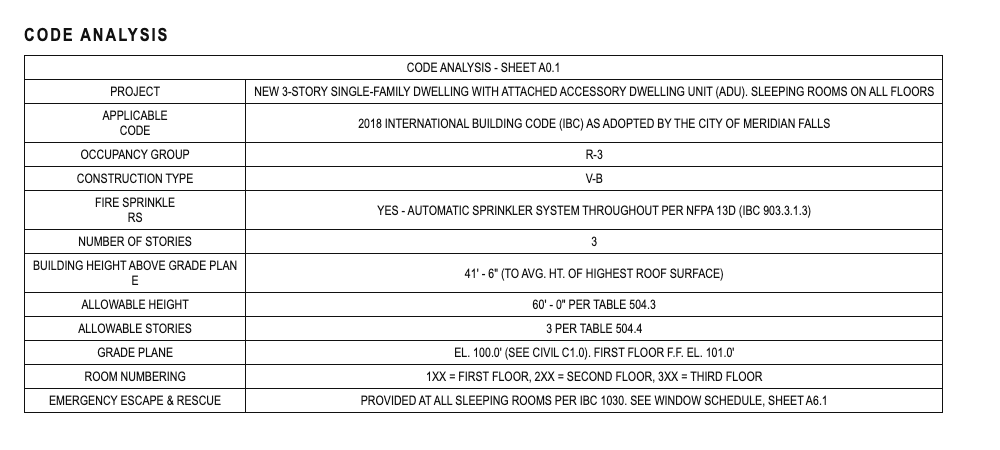
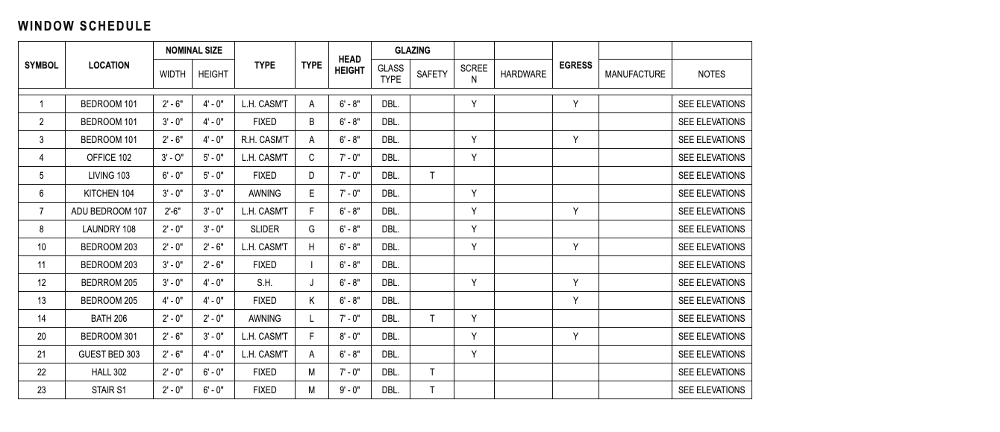
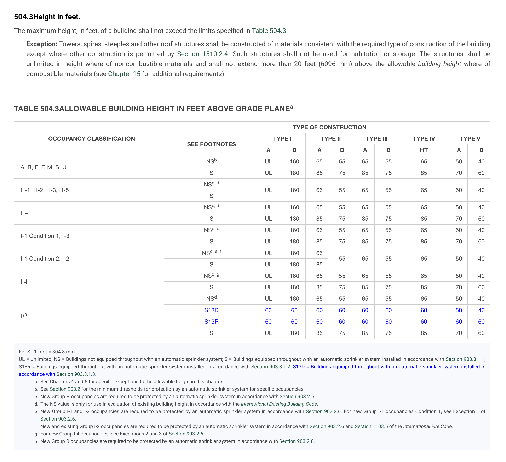
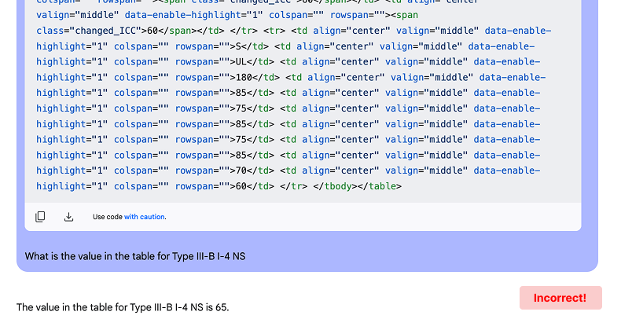
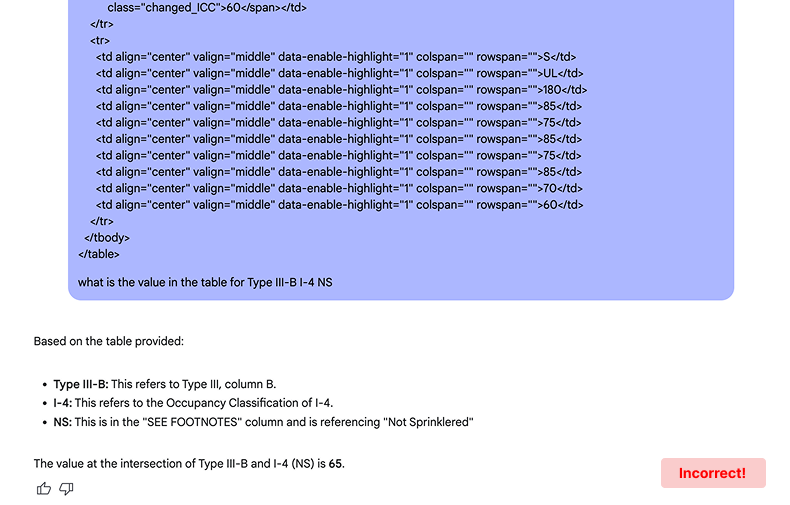
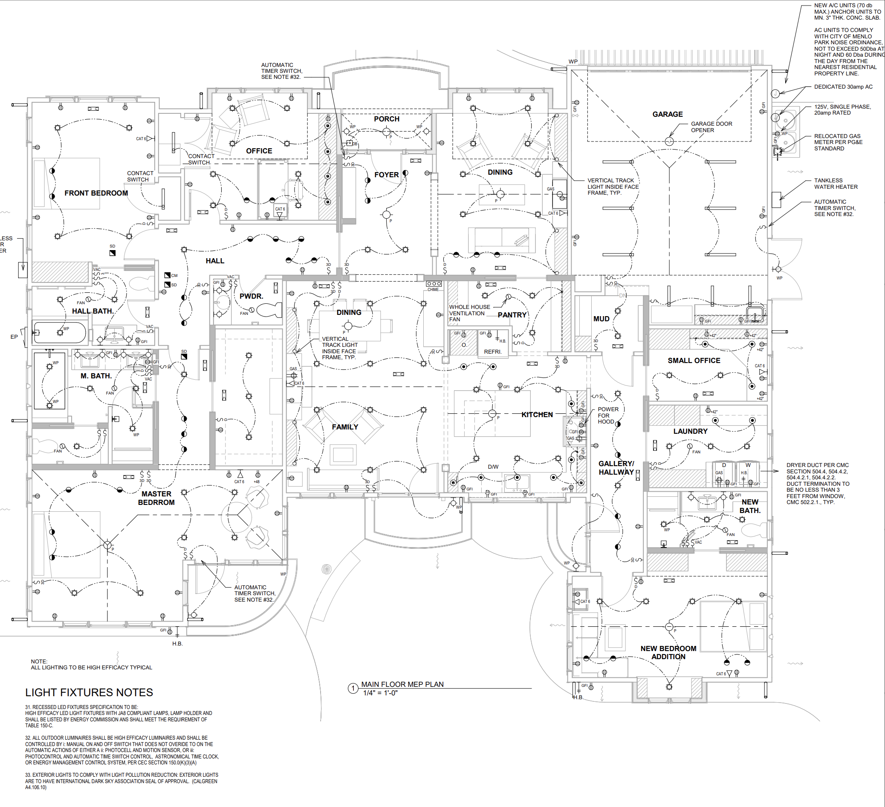

Ichi Coding Challenge
======================

## The challenge

Build a tool that reads two tables from a set of architectural drawings, checks them against two parts of the building code, and writes up what it finds in a Markdown report for a plan checker. Use an AI coding assistant to build it.

For each thing it checks, the report gives a verdict of `Pass`, `Fail`, `Could Not Evaluate` or `Not Applicable`, cites the code it used, and shows what it read from the drawings.

The short version:

- Inputs: two project files and three code files, all in [`./fixtures`](./fixtures).
- Checks: building height against IBC Table 504.3, and bedroom escape windows against IBC Section 1030. Both are explained below with worked examples.
- What you send us: your tool's source, the `REPORT.md` it generates from the fixtures, and a short `NOTES.md`.
- Time: plan on three to four focused hours. Please don't spend your weekend on this.

The report is the part we care about most, so lay it out the way you think a plan checker would actually want to read it.

You don't need any background in buildings or building codes. Everything you need is in this README and the fixture files.


## Use AI to build it

We want you to build this with an AI coding assistant like Claude Code, Cursor or Codex, and we expect it to write most of the code. That's how we work at Ichi. Writing the parser by hand won't earn you anything extra, and it'll eat time you'd be better off spending elsewhere.

What we're really looking at is the part the assistant can't do for you. How did you break the problem down and steer it? Did you check its work against the code text and the fixtures? (It will happily read the wrong cell of a table, or treat a window's nominal size as its clear opening, if nobody catches it.) Would you stand behind the verdicts in your report? And is the report something a plan checker would want to read?

Whoever typed it, you own every line and every verdict, and we'll ask you about both.


## What a plan checker does

When someone wants to build or remodel a building, they submit drawings to the city. A plan checker, who works for the city or for a consulting firm the city hires, reviews those drawings against the building code, a long rulebook that has the force of law. They go through it requirement by requirement: is this shown on the drawings, is it dimensioned, and does it comply?

Most projects don't get through on the first try. The plan checker sends back a numbered correction letter where each comment cites a code section and explains what's wrong or missing. The architect revises the drawings and resubmits, and this goes back and forth until everything complies.

Ichi builds software for plan checkers. Here's what a typical comment in a correction letter looks like:

> **12.** Window W-A at Bedroom 2 is designated as the emergency escape and rescue opening but is scheduled at 2'-0" x 2'-0", which cannot provide the 5.7 sq ft net clear opening required by IBC 1030.2. Provide a complying opening or revise the schedule.

Your tool produces the raw material for comments like that one. The plan checker reads your report and decides what actually goes in the letter.


## Words you'll need

| Term | What it means here |
|---|---|
| **Drawing set**, **sheet** | Architects submit drawings as a stack of large pages called sheets, numbered like `A0.1` or `A6.1`. Each sheet holds one kind of thing, like a floor plan, an elevation or a table, and the whole stack is the drawing set. |
| **Cover sheet** | The first sheet in the set (`A0.1` here). It has the project name, the list of sheets, the codes that apply, and the code analysis. |
| **Code analysis** | A table on the cover sheet where the architect sums up the building: what it's used for, how it's built, how tall it is, and the limits they looked up. Everything in it is the architect's claim. File: `fixtures/project/code-analysis.html`. |
| **Window schedule** | A table on its own sheet (`A6.1` here) that lists every window with its ID, room, size, type and a few flags. File: `fixtures/project/window-schedule.html`. |
| **Type mark** | A short code (`A`, `B`, `C`...) that points to a detail drawing of that window type somewhere else in the set. In the fixture schedule it's the second of the two `TYPE` columns. It doesn't tell you how the window opens; the first `TYPE` column does. |
| **IBC** | The International Building Code. We're using the 2018 edition. |
| **Occupancy group** | A code for what the building is used for. `R-3` is a house, `B` is an office, and `A` is assembly (theaters, restaurants and so on). A numbered group like `R-3` goes in the Table 504.3 row for its letter, `R`, unless the table gives the numbered group its own row, which it does for `H` and `I`. |
| **Construction type** | A label for how fire-resistant the structure is, from `I-A` (concrete and steel high-rises) down to `V-B` (wood-frame houses). |
| **Sprinklered** | Whether the building has fire sprinklers, and to which standard. `NFPA 13` is full commercial coverage, `NFPA 13R` is a lighter residential standard, and `NFPA 13D` is the lightest one, meant for houses. The better the sprinkler system, the taller the code lets you build. |
| **Grade plane** | The average ground level around the building. Building height is measured from here. |
| **Story**, **floor**, **level** | These mean the same thing on drawings. The first floor is the first story above grade plane, and so on up. The code analysis says how room numbers map to floors. |
| **Finished floor (F.F.)** | The top of the finished floor. `F.F. EL. 101.0'` is its elevation, its height relative to a reference point on the site. |
| **Sleeping room** | A room people sleep in. Anything named as a bedroom (`BEDROOM`, `BED`, `BDRM`, `GUEST BED` and so on) counts. People do sometimes sleep in dens, offices and lofts, so if a room name leaves you unsure, say so in the report instead of quietly guessing. |
| **Egress** / **emergency escape and rescue opening** | A window someone can climb out of in a fire, and a firefighter can climb in through. Most residential buildings need one in every bedroom. The schedule marks these in its `EGRESS` column. |
| **Nominal size** | The size of the window unit as ordered, including the frame. This is what the schedule gives you. |
| **Net clear opening** | The actual hole you can climb through with the window open. It's always smaller than the nominal size, by an amount that depends on the frame and how the window opens, and it's what the code regulates. |
| **Head height** | Height from the floor to the top of the window. The schedule gives this. |
| **Sill height** | Height from the floor to the bottom of the window. The code limits it, but the schedule doesn't list it. |
| **Casement / single hung / slider / fixed / awning** | How the window opens. A casement swings out like a door, so nearly the whole thing opens. A single hung slides up, so only the bottom half opens. A slider slides sideways and opens about half its width. An awning is hinged at the top and swings out at the bottom. A fixed window doesn't open. On schedules, `CASM'T` is casement and `S.H.` is single hung, and `L.H.` and `R.H.` (left hand and right hand) just say which side the hinge is on. |
| **Feet and inches** | `2' - 6"` is 2 feet 6 inches, or 30 inches. The spacing varies, so `2'-6"` means the same thing. |


## Inputs

Everything is in [`./fixtures`](./fixtures). The project and the city are made up, but the code text is real 2018 IBC.

The project documents in `fixtures/project/` come from our pipeline, which scans each sheet of a drawing set, finds the tables, and OCRs them into HTML. Yes, there are duplicate headers, typos, words split in half, etc. These are real issues and not to be glossed over.

`code-analysis.html` is the code analysis table from the cover sheet (A0.1):



`window-schedule.html` is the window schedule from sheet A6.1:



The rest of the drawing set (floor plans, elevations, window details, the civil sheet with the grade plane calculation) isn't included. If a check needs something only those sheets would show, that's what `Could Not Evaluate` is for.

The code files in `fixtures/code/` are the source of truth for what the code requires. The two check sections below summarize them so you can get your bearings, but if a summary and a code file ever disagree, go with the code file.

- [`table-504.3.html`](./fixtures/code/table-504.3.html) is IBC Table 504.3, allowable building height, scraped from the code website.
- [`table-504.3-notes.md`](./fixtures/code/table-504.3-notes.md) has the caption, legend and footnotes that the scrape dropped.
- [`section-1030-emergency-escape-and-rescue.md`](./fixtures/code/section-1030-emergency-escape-and-rescue.md) is IBC Section 1030, emergency escape and rescue openings, plus three related definitions.

Don't build your tool around these two particular files. Another project's tables would have different values, columns with different names in a different order, and their own OCR mistakes, and we may try your tool on one.


## Check 1: Building height vs. Table 504.3

Table 504.3 gives the maximum building height in feet. To use it, you find the row for the building's occupancy group, the sub-row for its sprinkler system, and the column for its construction type, and the cell where they meet is the limit. The legend in [`table-504.3-notes.md`](./fixtures/code/table-504.3-notes.md) explains the sub-row labels (`NS`, `S`, `S13R` and `S13D`). That's the short version; the table and its notes are the real reference.

Your tool should pull the occupancy group, construction type, sprinkler system and building height from the code analysis, look up the matching cell, compare the two heights, and report one finding for the building.

Here's a worked example using a different building. Say the code analysis reads:

```
OCCUPANCY GROUP:      B
CONSTRUCTION TYPE:    II-B
SPRINKLERS:           NONE
BUILDING HEIGHT:      52'-0"
```

Group `B` is in the table's first row (`A, B, E, F, M, S, U`). There are no sprinklers, so it's the `NS` sub-row, and construction type `II-B` is the `TYPE II` / `B` column. That cell says 55, and the building is 52 feet tall, so the finding is a **Pass**: measured 52'-0", allowed 55 ft, from Table 504.3 row `A, B, E, F, M, S, U` / `NS` / column `II-B`.

If the building were 56'-0", it would fail by a foot. If the code analysis didn't give a construction type at all, it would be **Could Not Evaluate**, because there'd be no way to pick a column.

A few things to watch for. Sprinklered buildings don't all use the same sub-row, since `S`, `S13R` and `S13D` give different limits for the same building, so read the legend. The code analysis also has an "allowable height" the architect filled in themselves, which is worth checking against the table rather than trusting. And you can ignore the stories and allowable stories lines (Table 504.4), which are out of scope here.


## Check 2: Bedroom escape windows vs. Section 1030

Section 1030 requires sleeping rooms in most residential buildings to have at least one window a person can climb out of in an emergency. Sections 1030.2 through 1030.3 put numbers on that. The window needs a net clear opening of at least 5.7 square feet (5.0 if it's a grade-floor opening, meaning one at or near ground level), at least 24 inches of clear height and 20 inches of clear width, and a sill no higher than 44 inches off the floor. Section 1030.1.1 says it has to open from the inside without keys or tools, and 1030.1 says which buildings and floors the rule covers. For some occupancy groups that depends on how many exits a story has, which you may find in the code analysis.

That's a summary and it skips the exceptions, so treat [`section-1030-emergency-escape-and-rescue.md`](./fixtures/code/section-1030-emergency-escape-and-rescue.md) as the real reference.

Some of what Section 1030 cares about can't be seen in these two documents, like whether a bedroom has its own door to the outside (Exception 2), whether the window opens onto a public way, yard or court, or whether the screens release from inside (1030.5). The same goes for anything the code text points to that isn't in `fixtures/code`. Don't make up verdicts for those. Say what you couldn't check and what document would settle it.

Your tool should check every window the schedule marks `EGRESS` and report a finding for each one. It should also report a finding for each sleeping room saying whether the room has a window that complies. That catches two cases the window findings alone would miss: a room whose only egress window fails, and a bedroom where nothing is marked egress at all. Windows in rooms people don't sleep in are `Not Applicable`.

Here's a worked example, again not from the fixtures:

```
SYMBOL: W-A   LOCATION: BEDROOM 2   NOMINAL SIZE: 2'-0" x 2'-0"   TYPE: CASEMENT   HEAD HEIGHT: 6'-8"   EGRESS: Y
```

It's a bedroom and the window is marked egress, so Section 1030 applies. The window is 2'-0" by 2'-0" nominal, which is 4.0 square feet, and since the clear opening is always smaller than the unit it can't possibly reach 5.7. That's a **Fail** under 1030.2.

Now a second window in the same room:

```
SYMBOL: W-B   LOCATION: BEDROOM 2   NOMINAL SIZE: 3'-0" x 3'-6"   TYPE: CASEMENT   HEAD HEIGHT: 7'-0"   EGRESS: Y
```

This one is 10.5 square feet nominal, well over 5.7. You can work out the sill height from what's given: 7'-0" of head height minus 3'-6" of window puts the sill around 3'-6", under the 44-inch limit. (If you derive a number like this, say so in the report and show how.) What the schedule doesn't give you is the net clear opening, and a casement loses a few inches to its frame, so you can't actually show it reaches 5.7. That makes it **Could Not Evaluate**, with a note that manufacturer data or a clear opening column on the schedule would settle it. If you'd rather call it a Pass based on an assumption about frame size, that's fine, as long as the assumption is written into the finding and you can defend it.

With one window failing and the other undetermined, Bedroom 2 itself is **Could Not Evaluate** until someone settles W-B.

The thing that trips people up most here is treating nominal size as the clear opening. A confident Pass or Fail that turns out to be wrong is much worse than an honest Could Not Evaluate. Window type matters too: a fixed window doesn't open at all, and a single hung only opens its bottom half.


## The report

Your tool writes its findings to `REPORT.md`, and the person reading it is a plan checker reviewing this project. They'll use it to decide what goes in the correction letter, so it should help them find the problems quickly, understand how you got to each verdict, and notice when your tool got something wrong.

How you lay it out is up to you, and it's a big part of how we evaluate the submission. We're intentionally not giving you a template. Some things to think about: What should the plan checker see first? How do they find every Fail without reading every row? If they disagree with a verdict, how quickly can they see what your tool read and which rule it used? Is there anything you want them to go and look at themselves?

Whatever the layout, every finding needs three things:

1. A verdict, using exactly these four: `Pass`, `Fail`, `Could Not Evaluate` and `Not Applicable`. Please don't rename them, since we use them to compare submissions. Only use Pass or Fail when the documents actually let you decide. Could Not Evaluate means the rule applies but the documents don't settle it, and Not Applicable means the rule doesn't apply here. For both, say why.
2. The code reference, down to the section number or table cell.
3. The evidence: what your tool read from the documents and anything it worked out from them, so a reviewer can trace a bad verdict back to where it came from.

There's no hidden test suite. We'll read your report the way a plan checker would and ask you to walk us through the verdicts.


## What to send us

A repository or zip with:

1. Your tool's source code. Any language, framework, library or model is fine. It should take a code analysis file and a window schedule file and write a new `REPORT.md`. Put the command to run it in your notes.
2. The `REPORT.md` your tool generated from the fixtures, exactly as it came out.
3. A short `NOTES.md` for us. Tell us how the tool works and which parts are plain code versus model calls, how you used AI to build it and how you checked what it gave you, and what you'd do with another day. Most of all, tell us what you couldn't verify and why.


## LLMs and tables

A picture is worth a thousand words<sup><a href="#footnotes-0">[0]</a></sup>, so here's Table 504.3 as it appears in the code:



_Source: [IBC 2018 Table 504.3](https://codes.iccsafe.org/content/IBC2018P6/chapter-5-general-building-heights-and-areas#IBC2018P6_Ch05_Sec504.3)_

You'll notice that the table has merged cells, merged headers, row values that serve as headers despite not being bolded, and more complexities.

So...how do we get an LLM to understand a table like this to answer:

_"What is the maximum height in feet of an I-4, III-B non-sprinklered building?" -- with 99% accuracy?_

🛑 Stop and answer the question yourself before looking at the LLM's answer.

`[Note: in that table S = Sprinklered, NS = Non-sprinklered]`

_Here's the above HTML sent to Gemini Flash 2.0:_




**LLMs can't see data the way we can**

LLMs are incredible, but the nature of tables is such that they are not particularly easy for LLMs to process with high precision.

If you think about it, when a human looks at a table, they don't read it from top to bottom, left to right. Instead, we visually scan vertically and horizontally to associate the categorical header values with a given value.

That's why this challenge is about more than parsing. Reading the table right is step one, and doing something correct with what you read is the actual job.


## Bonus ideas

These are very much optional, but if you want to go further:

- An evaluation set with expected verdicts for the fixture rows, and a script that scores your report against it.
- A second project package of your own, with the traps you think we forgot.
- A confidence level on each finding, and some thought on what a reviewer should do with a low-confidence Fail.
- A JSON file of the findings alongside the report.
- A paragraph on how this would hold up on a 200-sheet drawing set with 40 checks.


## Meta-instructions

### Reflection

We know and realize that this is a sandboxed, limited time challenge and not 100% representative of day-to-day work or real tradeoffs and problems.

In reality, you would not be working in such isolation on so little context. Our hope is that you'll find this problem intellectually interesting and challenging and embrace the unknowns.

This is **definitely not** a leetcode problem or the SAT - the goal is to simulate solving a real problem for the end user, not to get the "right answer". There are no gotchas or traps. If requirements are missing or unclear, that's either an intentional omission to give you more latitude and see how you think, or a misstep that happens to be a great reflection of real world constraints!

### Unknowns

Please feel free to ask clarification or guidance questions via email to andy@ichiplan.com, but please limit to maximum two questions.

We suggest that you do not block yourself waiting for a question to be answered, but rather use your best judgement to solve the problem. This is meant to be a real-world simulation after all.

### Be prepared to discuss

- How you steered the AI assistant, where it went wrong, and how you caught it
- Which parts are plain code and which call a model, and why you split them that way
- How you'd know if your tool read the wrong cell of Table 504.3
- What happens if the window schedule's columns come in a different order, or there's no `EGRESS` column
- Accuracy <> Speed <> Cost tradeoffs
- Why you laid out the report the way you did
- What you couldn't verify, and what document would have settled it


## Footnotes

<div id="footnotes-0">
  <sup>[0]</sup> We've discovered that this idiom is a MASSIVELY under-estimated ratio. The first version of our "file vault" had 2000 word text-only descriptions of images, which was useful for high-level summaries and understanding, but absolutely useless when it comes to answering complex questions we can't know ahead of time, like "How many recessed lights are there in the dining room?" — of a complex architectural diagram like this one:
</div>


